# Figures

The dark versions use the [midnight navy palette](PALETTE.md). Every SVG embeds the exact PNG extracted from the Word report and changes its displayed colors with a filter. The original PNGs remain available for checking plotted lines, labels, and values.

## Figure 1 · Study workflow

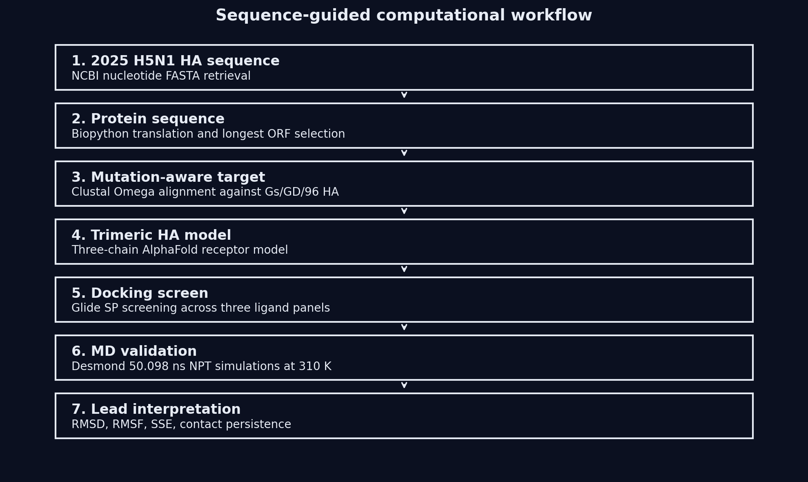

[Original PNG](figures/original/figure-01-workflow.png)

## Figure 2 · Docking scores

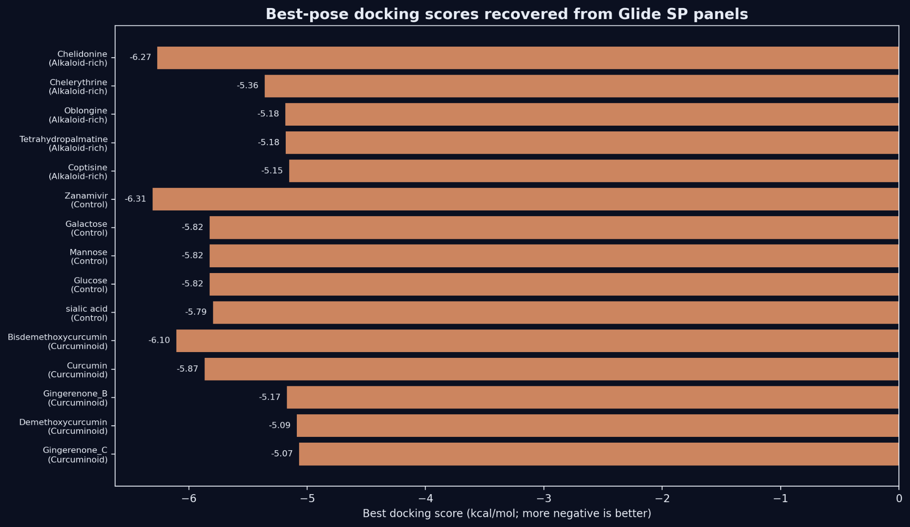

[Original PNG](figures/original/figure-02-docking-scores.png)

## Figure 3 · Protein and ligand RMSD

The report presents these panels in the order chelidonine, bisdemethoxycurcumin, and zanamivir.

### Chelidonine

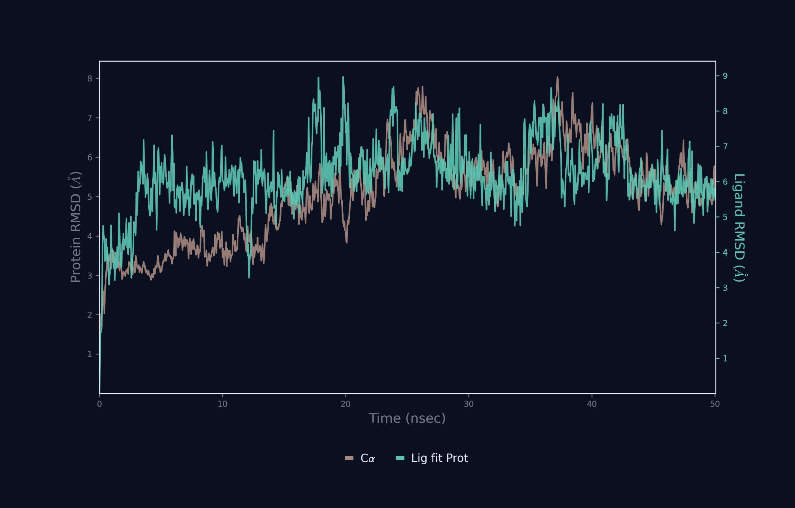

[Original PNG](figures/original/figure-03a-chelidonine-rmsd.png)

### Bisdemethoxycurcumin

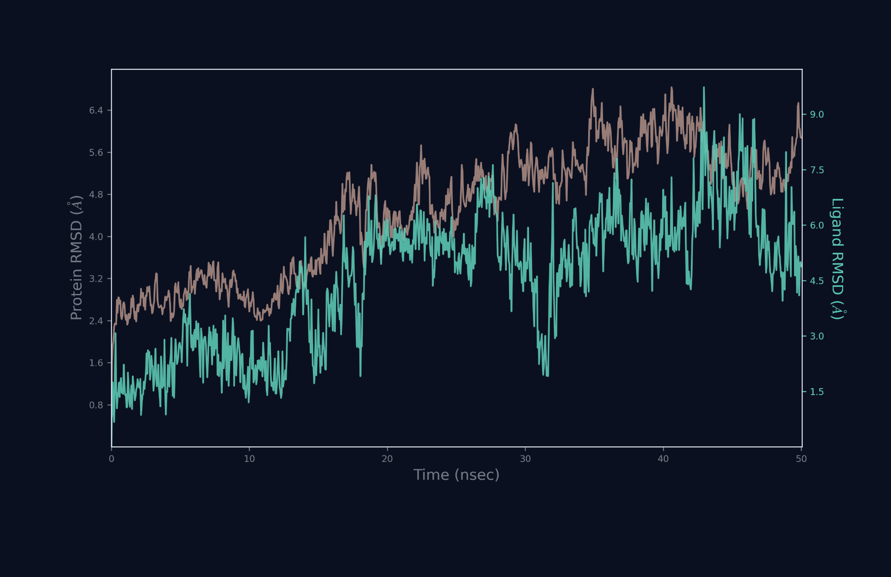

[Original PNG](figures/original/figure-03b-bisdemethoxycurcumin-rmsd.png)

### Zanamivir

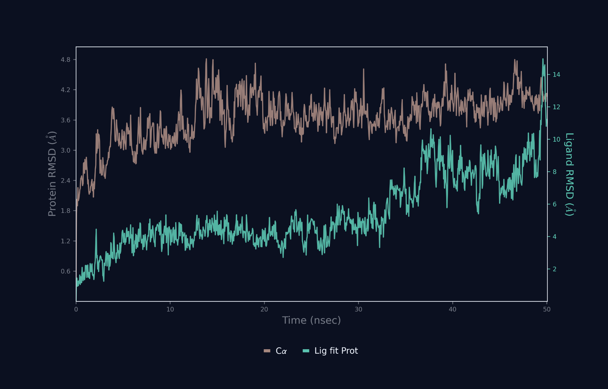

[Original PNG](figures/original/figure-03c-zanamivir-rmsd.png)

## Figure 4 · Contact timelines

### Chelidonine

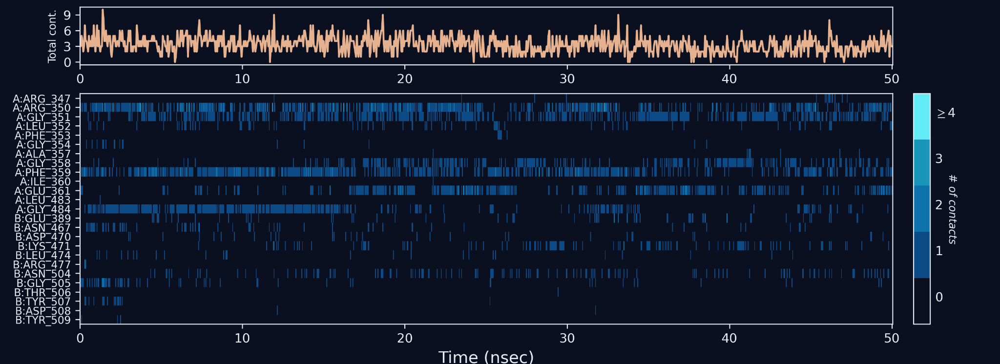

[Original PNG](figures/original/figure-04a-chelidonine-contacts.png)

### Bisdemethoxycurcumin

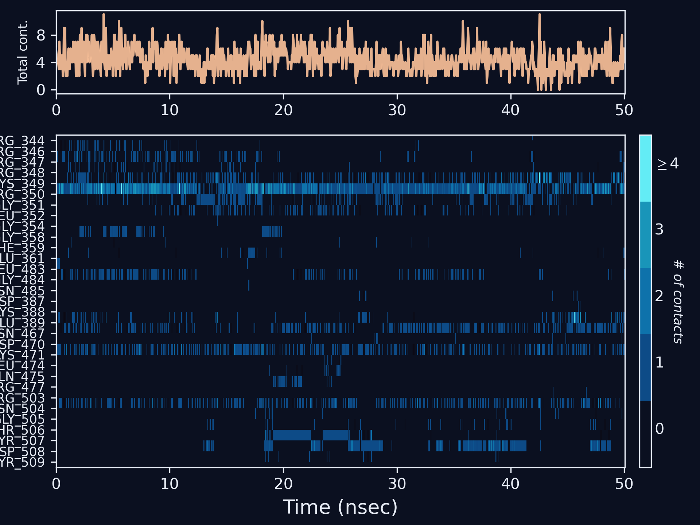

[Original PNG](figures/original/figure-04b-bisdemethoxycurcumin-contacts.png)

### Zanamivir

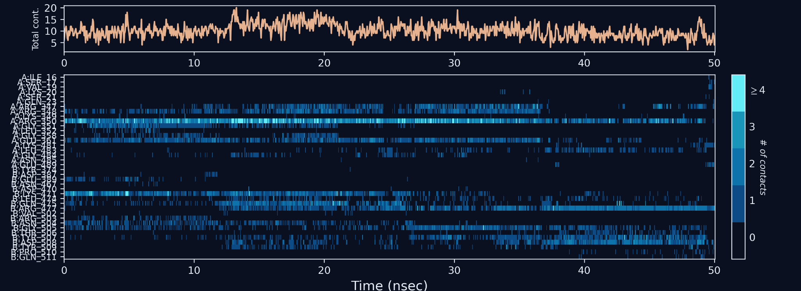

[Original PNG](figures/original/figure-04c-zanamivir-contacts.png)

## Figure 5 · High-occupancy contact schematics

### Chelidonine

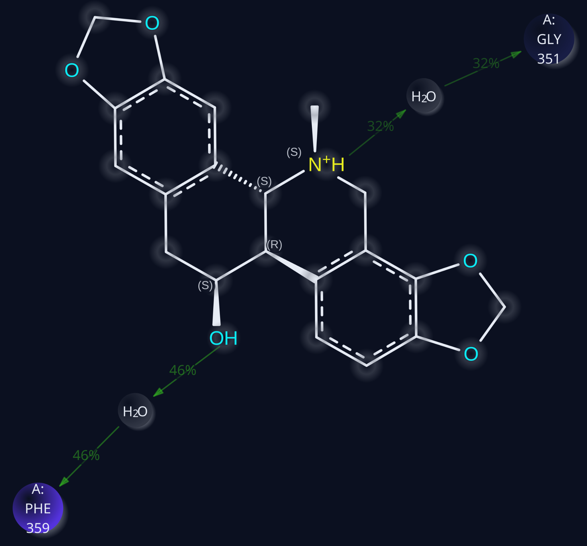

[Original PNG](figures/original/figure-05a-chelidonine-interactions.png)

### Bisdemethoxycurcumin

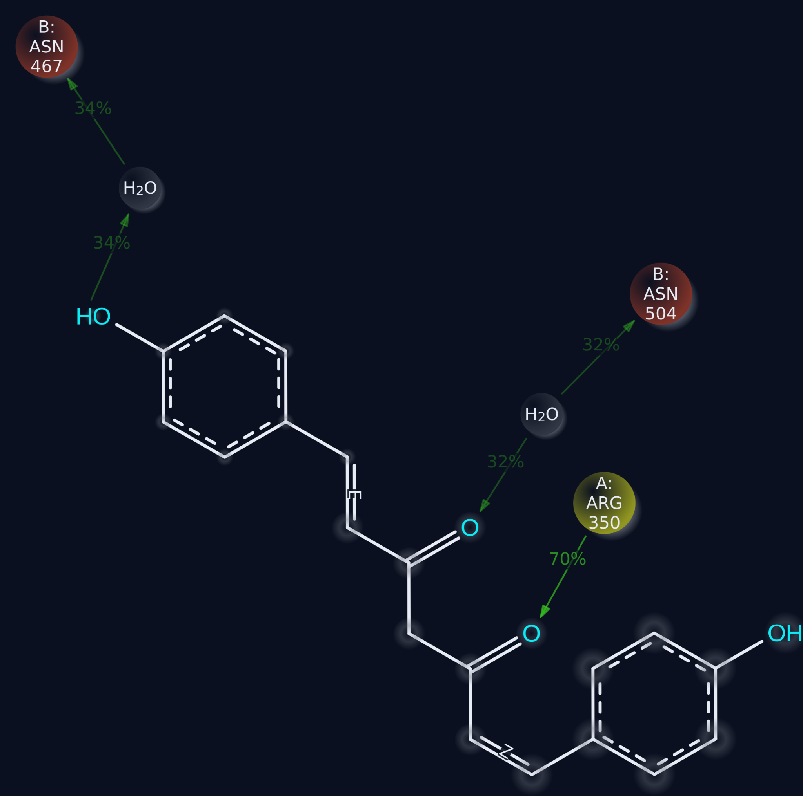

[Original PNG](figures/original/figure-05b-bisdemethoxycurcumin-interactions.png)

### Zanamivir

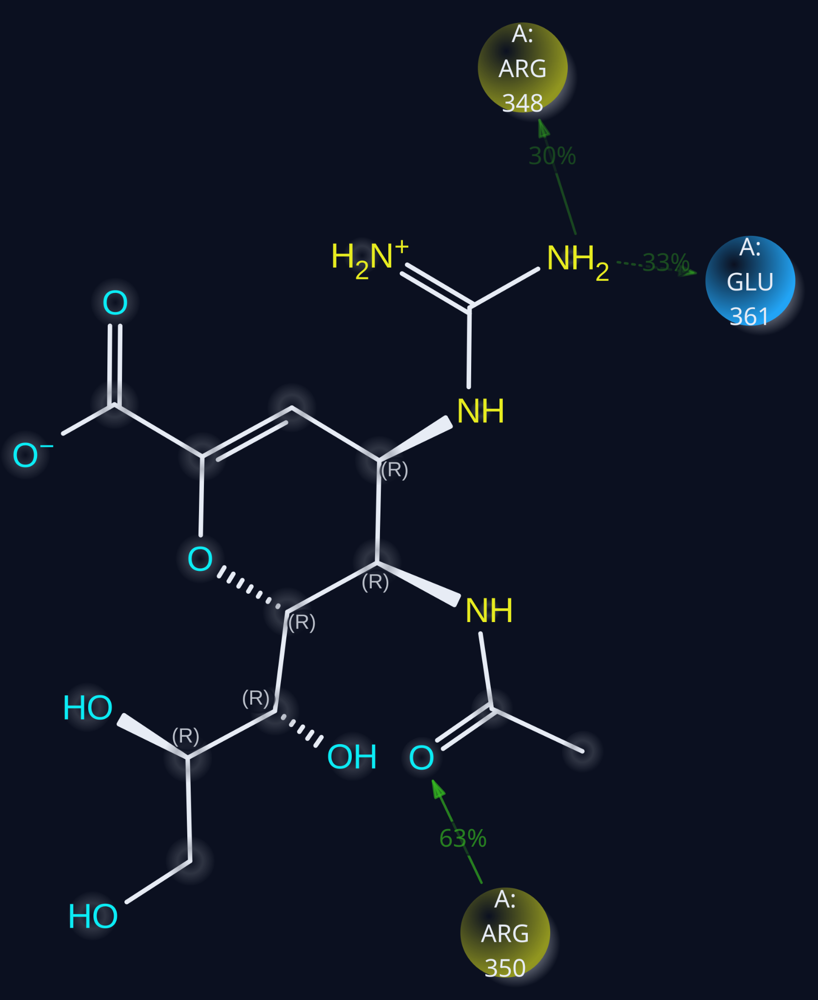

[Original PNG](figures/original/figure-05c-zanamivir-interactions.png)

## Figure 6 · Reported persistent contacts

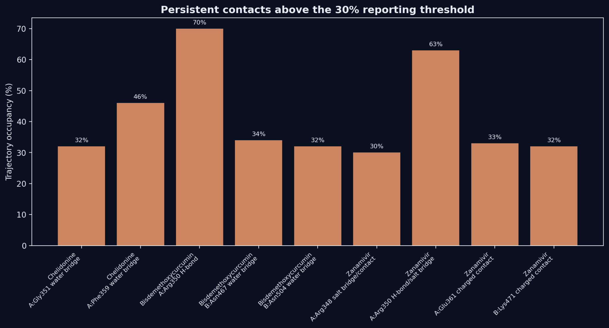

[Original PNG](figures/original/figure-06-contact-occupancy.png)
