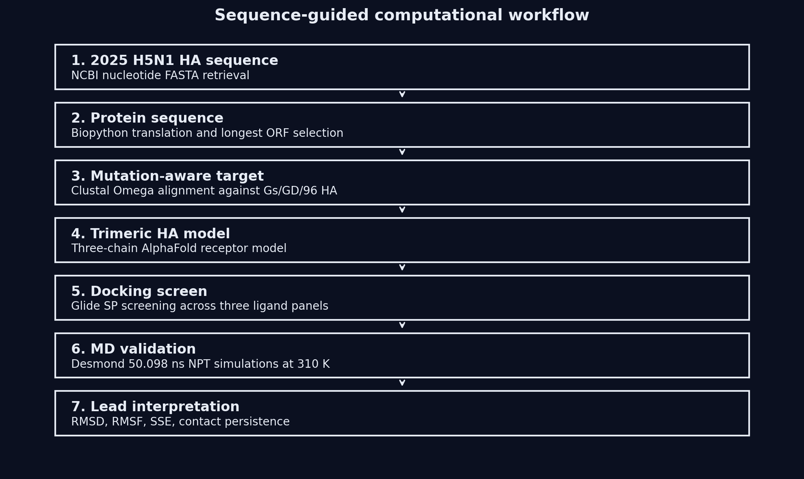
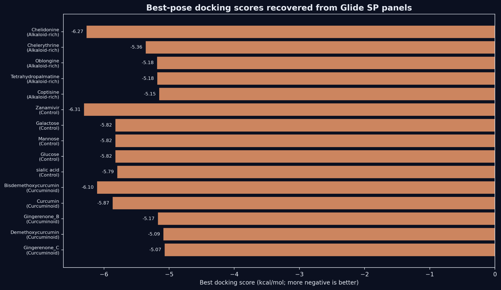

# H5N1 HA ligand prioritization

**An archive of a sequence-guided computational study of H5N1 hemagglutinin (HA).** The report compares natural-product ligands with a docking-selected antiviral comparator using a modeled HA trimer, Glide SP docking, and short Desmond molecular dynamics (MD) simulations.

## Study at a glance

| Item | Archived report |
| --- | --- |
| Target sequence | Influenza A/Nevada/10/2025(H5N1) HA, GenBank `PV113341.1`; protein `XOL43332.1` |
| Reference | A/goose/Guangdong/1/1996(H5N1) HA, GenBank `AF144305` |
| Receptor | Sequence-derived, modeled HA trimer |
| Screen | 58 unique ligands in three panels, screened with Glide SP |
| MD comparison | One 50.098 ns Desmond trajectory per selected complex |
| Selected ligands | Chelidonine, bisdemethoxycurcumin, and zanamivir |

The report prioritizes **chelidonine** for its localized retention in the modeled system and **bisdemethoxycurcumin** for a persistent Arg350-centered contact despite greater motion. **Zanamivir** was a docking-selected comparator. It is a neuraminidase inhibitor, not an established HA inhibitor.

These are **exploratory computational observations**. The report does not establish antiviral activity, binding affinity, or resilience across H5N1 mutations.

## Figures

[Browse all 12 dark figures, with links to the originals](FIGURES.md). The dark versions preserve the source pixels and change their displayed colors through an SVG filter. They are presentation copies; the PNGs extracted from the report are the reference images.

## What is archived

- [Full Word report](report/study-report.docx)
- [Original extracted figures](figures/original)
- [Dark figure displays](figures/dark)
- [Figure index and captions](FIGURES.md)
- [Palette and image treatment](PALETTE.md)

The original scripts, input structures, docking files, MD trajectories, and raw measurements were not available when this repository was assembled. This is a **report archive**, not a runnable reproduction of the workflow. The report also says the docking grid coordinates were unavailable from the archived project files.

## Reading the results

The screening scores were around −6 kcal/mol for the three MD-selected ligands. They are ranking values from docking, not measured binding free energies. Each ligand has only one short MD trajectory, so its apparent retention cannot support a statistical rank or a residence-time estimate. The modeled trimer omits some biological context, including full glycosylation and the membrane. No experimental binding or viral entry assay is reported.

The report contains an internal residue-count inconsistency: the methods section describes **three chains of 572 residues** (**1716 total**), while a results passage states **1728**. The report is preserved as received, and this archive does not resolve the underlying model count without source files.

## Authors

Sri Venkata Satya Sai Eswar Moparti · Debojyoti Chatterjee · Vivin Francis · Shravan Kumar K. S.

Department of Biotechnology and Bioinformatics, JSS Academy of Higher Education and Research, Mysuru, Karnataka, India.

## Citation

Please cite the [archived report](report/study-report.docx) and credit all four authors.
