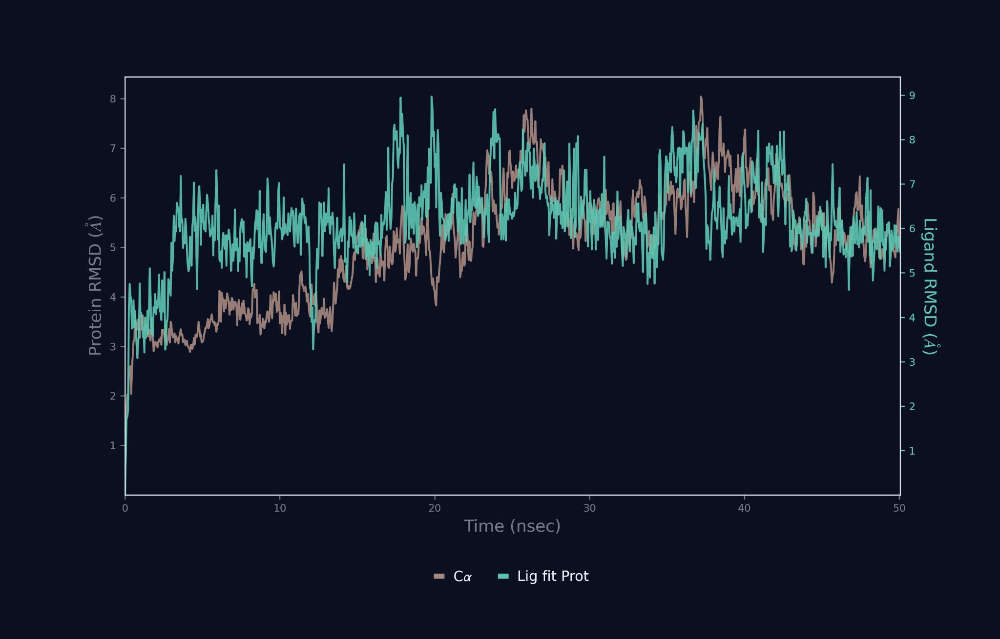
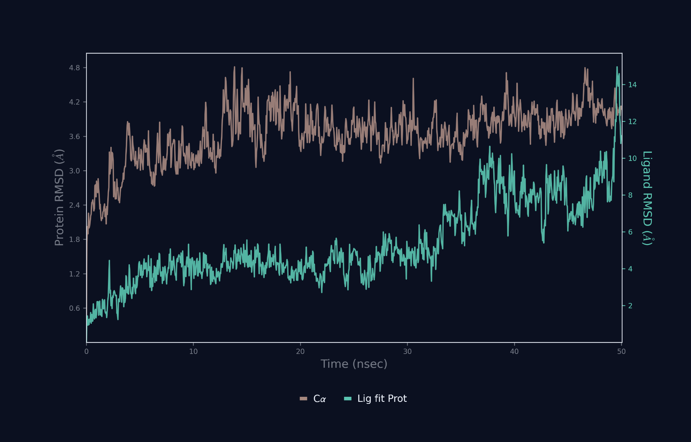
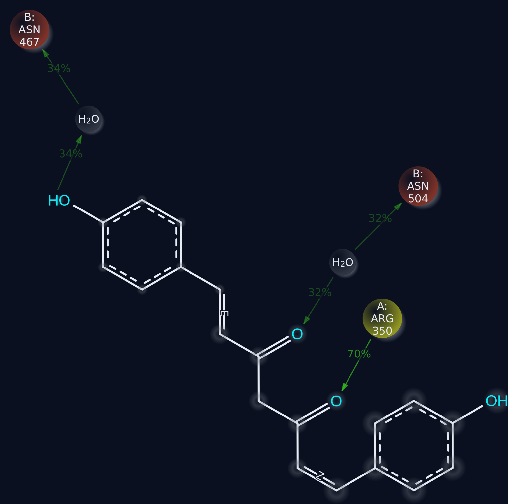
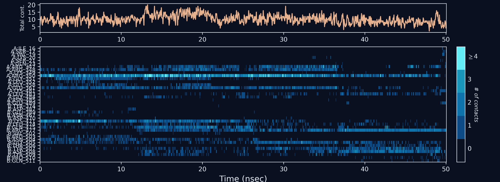
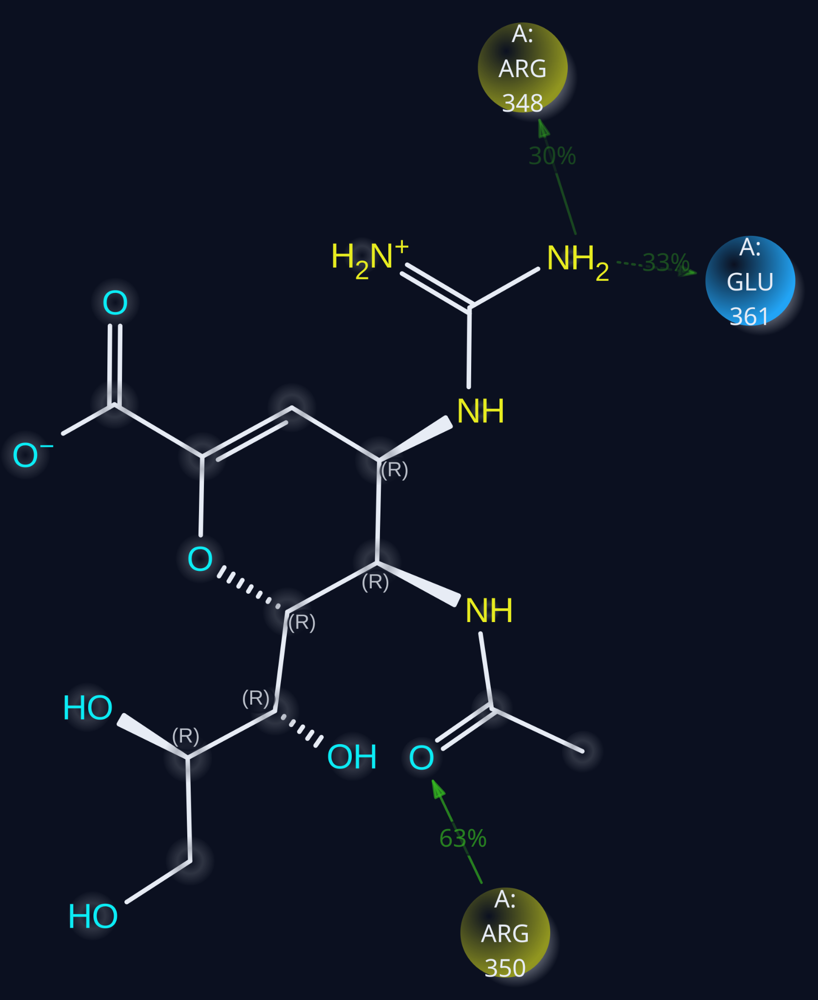
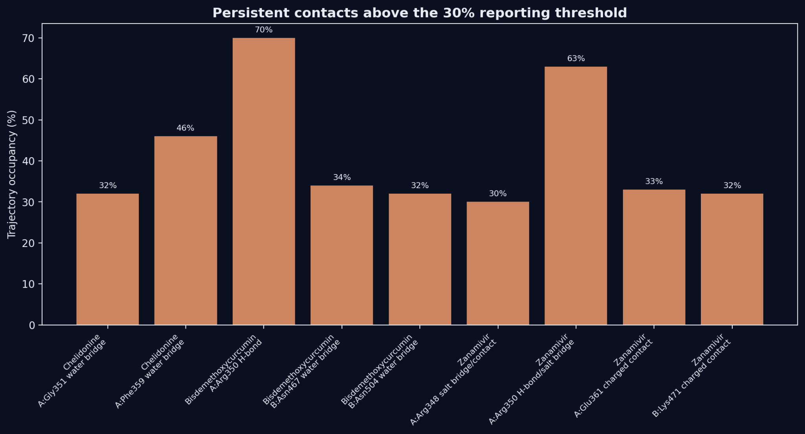

# H5N1 HA ligand prioritization

### A sequence-guided computational study archive

This repository preserves a report on the **hemagglutinin (HA)** protein of influenza A/Nevada/10/2025(H5N1). The study used a sequence-derived HA model, molecular docking, and short molecular dynamics (MD) simulations to compare plant-derived compounds with a docking-selected antiviral comparator. It is an archive of the completed report and its figures, not a runnable workflow: the original scripts, structures, docking outputs, and MD trajectories are no longer available.

**The main finding is a prioritization for follow-up.** In the reported simulations, chelidonine showed the most coherent local retention, while bisdemethoxycurcumin kept a strong Arg350-centered contact despite greater motion. Zanamivir scored best in its docking panel but showed more late-stage positional drift. These observations do **not** establish HA inhibition, antiviral activity, binding affinity, or resilience across H5N1 mutations.

> [Read the full report](report/study-report.docx) · [See original PNG figures](figures/original) · [View the color palette](PALETTE.md)

## Contents

1. [Research question](#research-question)
2. [How the study was done](#how-the-study-was-done)
3. [Docking screen](#docking-screen)
4. [MD comparison](#md-comparison)
5. [What each ligand showed](#what-each-ligand-showed)
6. [Contact occupancy and interpretation](#contact-occupancy-and-interpretation)
7. [Limits and archive contents](#limits-and-archive-contents)
8. [Authors](#authors)

## Research question

HA helps influenza attach to sialic-acid-containing receptors and begin viral entry. Its receptor-binding region is shallow, flexible, and exposed to water, so a favorable docking pose may not remain in place when the protein and solvent move. The study asked whether selected natural-product ligands would retain plausible contacts with a **modeled H5N1 HA trimer** during MD, and how their behavior compared with a docking-selected polar antiviral compound.

The report's title uses “mutation-resilient,” but the available analysis concerns one 2025 HA sequence compared with a historical reference. It does not test ligand performance across multiple HA variants.

## How the study was done

The workflow began with HA nucleotide sequence **PV113341.1** from A/Nevada/10/2025(H5N1), linked in the report to protein **XOL43332.1**. The sequence was translated, aligned against A/goose/Guangdong/1/1996(H5N1) HA (**AF144305**), and used to model a three-chain HA receptor. The report then describes Glide SP docking across three ligand panels and a Desmond MD comparison of one selected compound from each panel.

*Figure 1. Sequence retrieval → translation → reference alignment → trimer modeling → docking → MD → interpretation. [Original figure](figures/original/figure-01-workflow.png). The source figure calls the MD step “validation”; here we treat it as exploratory evaluation because only one short trajectory was run per ligand.*

| Stage | Reported setup |
| --- | --- |
| Sequence | 1,749 bp HA coding sequence, GenBank `PV113341.1` |
| Reference | Historical HA sequence `AF144305` |
| Structure | Sequence-derived, modeled HA trimer |
| Docking | Glide SP, three ligand panels |
| MD | Desmond, one **50.098 ns** trajectory per complex, NPT at **310 K**, OPLS4, TIP3P water, Na⁺/Cl⁻ ions |
| Readouts | Protein and ligand RMSD, RMSF, secondary structure, contact timelines, and contact occupancy |

## Docking screen

The three reported panels contained **58 unique ligands**. The best docking pose in each panel selected one representative for MD. Scores helped triage compounds within the screen; they are model scores, not measured binding free energies.

| Panel | Ligands | Docked poses | MD representative | Best docking score |
| --- | ---: | ---: | --- | ---: |
| Alkaloid-rich natural products | 24 | 147 | Chelidonine | −6.26509 |
| Curcuminoid and ginger-associated products | 23 | 53 | Bisdemethoxycurcumin | −6.10451 |
| Control comparators | 11 | 397 | Zanamivir | −6.30614 |

*Figure 2. Best-pose scores for five compounds per panel. Zanamivir had the most favorable score among the three MD representatives. [Original figure](figures/original/figure-02-docking-scores.png).*

**Why zanamivir?** It ranked first in the comparator panel and provided a polar antiviral scaffold for the computational comparison. Zanamivir is a **neuraminidase inhibitor**; the study did not use it as a validated HA-positive control.

## MD comparison

Each ligand-bound HA trimer was simulated once for 50.098 ns. The report describes similar system sizes and roughly 50% secondary-structure content across the three complexes, allowing a qualitative comparison of ligand motion in similarly prepared systems. The figures below show protein Cα RMSD and ligand RMSD after fitting the protein. RMSD describes movement relative to a starting position; it is **not**, by itself, a binding-energy or residence-time measurement.

### Chelidonine · RMSD

*Figure 3a. Chelidonine's reported trajectory showed comparatively coherent ligand motion without a clear late uncoupling event. [Original figure](figures/original/figure-03a-chelidonine-rmsd.png).*

### Bisdemethoxycurcumin · RMSD

*Figure 3b. The flexible curcuminoid moved more, but contact analysis was needed to determine whether motion occurred around an anchor. [Original figure](figures/original/figure-03b-bisdemethoxycurcumin-rmsd.png).*

### Zanamivir · RMSD

*Figure 3c. The report interprets later ligand motion as positional drift despite several persistent local contacts. [Original figure](figures/original/figure-03c-zanamivir-rmsd.png).*

## What each ligand showed

Contact timelines show **when** residues interacted with each ligand. The interaction schematics show the contacts that passed the report's roughly 30% occupancy threshold. They help explain the RMSD curves, but a contact alone does not prove inhibition of HA's biological function.

### Chelidonine · compact local retention

Chelidonine was the highest-ranked ligand in the alkaloid-rich docking panel. The report describes it as a relatively rigid scaffold with one rotatable bond. Two recurring **water-mediated** contacts in chain A, Gly351 (**32%**) and Phe359 (**46%**), supported a localized retention pattern in this trajectory.

*Figure 4a. Repeated contact events during the chelidonine simulation. [Original timeline](figures/original/figure-04a-chelidonine-contacts.png).*

*Figure 5a. The reported Gly351 and Phe359 water bridges. [Original schematic](figures/original/figure-05a-chelidonine-interactions.png).*

### Bisdemethoxycurcumin · flexible anchoring

Bisdemethoxycurcumin led the curcuminoid and ginger-associated panel. It has more internal flexibility than chelidonine, yet the report records an **A:Arg350** contact for **70%** of the trajectory, plus water-mediated contacts with **B:Asn467 (34%)** and **B:Asn504 (32%)**. The chain-B contacts illustrate why the trimeric context mattered to the authors' interpretation. This is an exploratory contact pattern in one model and one trajectory.

*Figure 4b. Contact timing for the flexible curcuminoid. [Original timeline](figures/original/figure-04b-bisdemethoxycurcumin-contacts.png).*

*Figure 5b. Arg350-centered anchoring and the reported chain-B water bridges. [Original schematic](figures/original/figure-05b-bisdemethoxycurcumin-interactions.png).*

### Zanamivir · contact-rich comparator with drift

Zanamivir ranked highest in its docking panel and formed several contacts in MD: **A:Arg350 (63%)**, **A:Glu361 (33%)**, **A:Arg348 (30%)**, and **B:Lys471 (32%)**. The report nonetheless describes greater late-stage positional drift. This contrast is the reason the study considered dynamics alongside docking: having contacts at some times did not guarantee the original pose stayed spatially stable.

*Figure 4c. Zanamivir's contact events during the simulation. [Original timeline](figures/original/figure-04c-zanamivir-contacts.png).*

*Figure 5c. The comparator's reported high-occupancy contact network. [Original schematic](figures/original/figure-05c-zanamivir-interactions.png).*

## Contact occupancy and interpretation

*Figure 6. Summary of the contacts reported at or above approximately 30% occupancy. [Original figure](figures/original/figure-06-contact-occupancy.png).*

The report's qualitative order was **chelidonine → bisdemethoxycurcumin → zanamivir** for dynamic retention in this specific modeled system. That order combines docking rank, ligand motion, and contact persistence. It is **not a statistically established potency ranking**. In particular, zanamivir's role is a docking-selected comparator, not an HA inhibitor control.

## Limits and archive contents

- **One trajectory per ligand:** No replicate MD runs or ensemble convergence analysis was available. Apparent retention could change with different starting conditions or longer simulations.
- **Modeled target:** The trimer was not an experimental structure of this 2025 strain. Full glycosylation, membrane context, and other HA states were not included.
- **Incomplete docking setup:** The archived report says the original docking-grid coordinates and box dimensions were unavailable.
- **No experimental validation:** The report does not include binding, viral-entry, or antiviral assays.
- **No variant panel:** The title's mutation-resilience idea remains untested by the available results.
- **A source inconsistency:** The methods describe three chains of 572 residues (**1716 total**), while a results passage states **1728**. The source files needed to settle that discrepancy are unavailable, so the report remains unchanged.

This repository contains the [full Word report](report/study-report.docx), [12 original figures](figures/original), [12 dark displays](figures/dark), a [figure index](FIGURES.md), the [palette guide](PALETTE.md), and a [script to regenerate the dark displays](scripts/build_dark_figures.py). Every dark SVG embeds its original PNG and changes only the displayed colors; the original PNGs are the reference for scientific reading.

## Authors

**Sri Venkata Satya Sai Eswar Moparti · Debojyoti Chatterjee · Vivin Francis · Shravan Kumar K. S.**

Department of Biotechnology and Bioinformatics, JSS Academy of Higher Education and Research, Mysuru, Karnataka, India.

Please credit all four authors and cite the [archived report](report/study-report.docx) when referring to this study.
